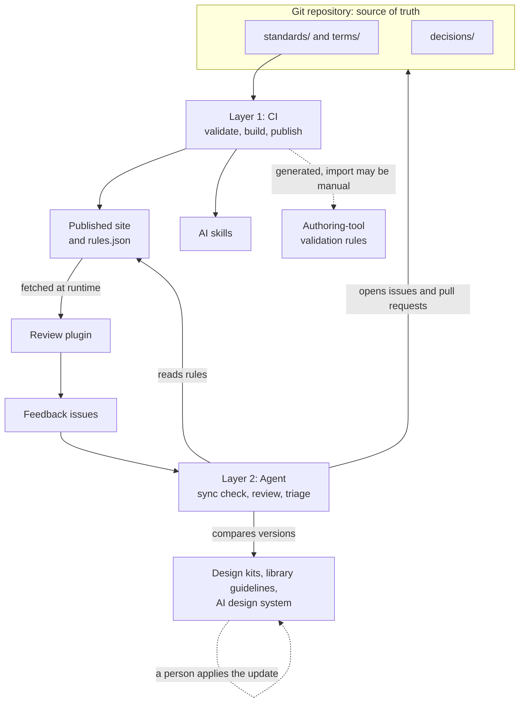

# Architecture

One repository holds the rules. Two layers keep every tool in step with it.

## The two layers

**Layer 1: CI (GitHub Actions).** Anything that can be built from the files in this repository happens automatically on every merge: validate, build `rules.json` and the Schematron file, publish the site, and check that copies match.

**Layer 2: Agent.** Anything that needs a signed-in tool or a judgment call is handled by an agent: checking what a design kit is using, comparing an AI design system with the README, reviewing recent content, and triaging feedback. The agent opens issues and pull requests. People approve.

## Diagram

Solid arrows are automatic. Dashed arrows need a person, or depend on what your tool supports.

## What updates how

| Destination | How it stays current | Manual step |
|---|---|---|
| Published site and `rules.json` | CI on every merge to `main` | None |
| Review plugin | Reads `rules.json` when it runs | Publish the plugin once |
| AI skills | `scripts/sync_standards.py`, checked in CI | Re-upload skills if you load them through an app's settings |
| Authoring-tool validation | `dist/terms.sch` generated by CI | Import the file, if your tool needs that |
| Design kits and library guidelines | The agent reports what is stale | A person copies in the update |
| AI design system | The agent reports what is stale | A person applies the update |

## Why not automate everything

Some tools only accept updates through their own interface, or through a signed-in connector. Where a tool offers a connector or API you trust, you can move that destination from the agent's list to CI. Start with the manual step, and automate it once it's stable.

## Detecting stale copies

`VERSION` is the current version. `dist/manifest.json` lists the version and a hash of each published file. The agent compares these with what each tool is using, and opens one issue per stale destination.
